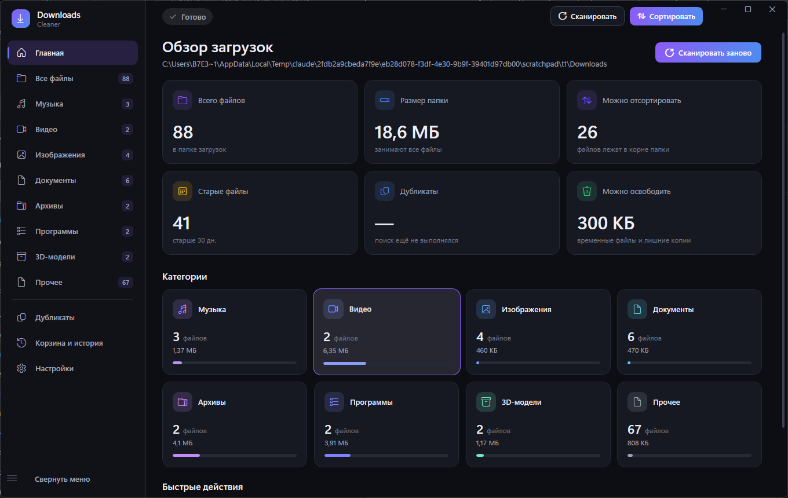

# Downloads Cleaner

Нативное Windows-приложение (WPF, .NET 8) для разбора и безопасной очистки папки «Загрузки»:
сканирует папку, определяет типы файлов, раскладывает их по категориям (виртуально или физически),
ищет старые, крупные, временные файлы и точные дубликаты, отправляет лишнее в Корзину Windows и
следит за появлением новых загрузок.

Тёмная (графит + фиолетово-синие акценты) и светлая темы, плавные анимации, внутренние
уведомления (toast), предпросмотр изображений, аудио, видео и текстовых документов.

Интерфейс на русском и английском: язык переключается на лету в настройках и сохраняется между запусками.



## Быстрый старт

### Скачать

На странице [Releases](https://github.com/Revesane/DownloadsCleaner/releases):

* **Windows — `DownloadsCleanerSetup.exe`**: установщик без прав администратора (программа ставится
  в `%LocalAppData%\Programs\DownloadsCleaner`), ярлык в «Пуске» и по желанию на рабочем столе,
  галочка «Запускать вместе с Windows», удаление через «Приложения». Или `DownloadsCleaner-win-x64.zip` —
  та же программа без установки.
* **macOS — `DownloadsCleaner-macOS-AppleSilicon.dmg` / `…-Intel.dmg`**: откройте образ и перетащите
  программу в «Программы». Открытие при входе в систему — переключатель в настройках. Программа
  не подписана сертификатом Apple, поэтому при первом запуске macOS спросит разрешение:
  щёлкните по программе правой кнопкой → «Открыть».

**Обновления.** Настройки → «О программе» → «Проверить обновления»: программа сама скачает новую
версию с GitHub, заменит свой exe и перезапустится (старый файл остаётся рядом как `.old` до
следующего запуска). По умолчанию одна короткая проверка выполняется и при запуске — её можно
выключить там же. Сборка для разработки себя не обновляет: для неё кнопка открывает страницу выпуска.

**Новый выпуск** собирает GitHub Actions (`.github/workflows/release-windows.yml`): достаточно
отправить тег вида `v1.2.3` — версия exe берётся из тега. Сообщение тега становится описанием
выпуска (его же показывает кнопка обновления в программе); без сообщения GitHub составит список
изменений сам.

```powershell
git tag -a v1.2.3 -m "Что нового: …"
git push origin v1.2.3
```

### Готовая сборка локально

После выполнения `publish.ps1` готовое приложение лежит в `publish\win-x64\DownloadsCleaner.exe`
(один файл, self-contained: **.NET устанавливать не нужно**, Windows 10 1809+ / Windows 11, x64).
Просто запустите `DownloadsCleaner.exe`.

Вариант с портативными данными (настройки и история рядом с программой, в папке `data`) —
`Portable\DownloadsCleaner-Portable\DownloadsCleaner.exe`.

> **Важно.** Запускать нужно именно эти exe (self-contained, ~64 МБ). Файл
> `src\DownloadsCleaner\bin\Release\net8.0-windows\DownloadsCleaner.exe` (~0,2 МБ) — обычная
> сборка для разработки: ей требуется установленный .NET 8 Desktop Runtime. Без него Windows
> показывает окно «You must install or update .NET to run this application».

### Версия для macOS

Приложение работает и на macOS: интерфейс собран на Avalonia (кроссплатформенный XAML),
а вся логика — общая с Windows-версией.

Сборка (нужен macOS и [.NET 8 SDK](https://dotnet.microsoft.com/download/dotnet/8.0)):

```bash
./build-mac.sh            # Apple Silicon (osx-arm64)
./build-mac.sh osx-x64    # Intel
open "publish/macos/osx-arm64/Downloads Cleaner.app"
```

Готовая сборка для macOS делается в CI: workflow `.github/workflows/build-macos.yml`
собирает `.app` для Apple Silicon и Intel и выкладывает их артефактами
(кнопка **Run workflow** во вкладке Actions).

Что отличается от Windows-версии:

* удаление отправляет файлы в **Корзину macOS** (Finder), восстановление — средствами системы;
* «Показать в Проводнике» открывает файл в Finder (`open -R`);
* предпросмотр показывает изображения и текст; аудио и видео открываются во внешней программе
  (встроенного проигрывателя в macOS нет);
* квота Корзины macOS неизвестна — программа не может проверить её заранее и не мешает Finder;
* окно использует стандартную системную рамку macOS, а не собственный заголовок.

### Сборка из исходников

Требуется [.NET 8 SDK](https://dotnet.microsoft.com/download/dotnet/8.0) (Windows).

```powershell
# запуск в режиме разработки (Windows-версия)
dotnet run --project src\DownloadsCleaner\DownloadsCleaner.csproj

# запуск macOS-версии на Windows (Avalonia) - для проверки интерфейса
dotnet run --project src\DownloadsCleaner.Mac\DownloadsCleaner.Mac.csproj

# тесты (110 тестов, работают только во временных папках)
dotnet test

# self-contained сборка для Windows x64 (+ zip-архив)
.\publish.ps1
```

Команда, которую выполняет `publish.ps1`:

```powershell
dotnet publish src\DownloadsCleaner\DownloadsCleaner.csproj -c Release -r win-x64 --self-contained true `
    -p:PublishSingleFile=true -p:IncludeNativeLibrariesForSelfExtract=true -p:EnableCompressionInSingleFile=true `
    -o publish\win-x64
```

## Возможности

| Раздел | Что делает |
|---|---|
| **Главная** | Количество файлов, размер папки, сколько можно отсортировать, старые файлы, дубликаты, потенциально освобождаемое место; карточки категорий с заполнением; быстрые действия |
| **Все файлы / категории** | Список с виртуализацией (проверено на 30 000 файлов): выбор одного/нескольких/всех, поиск по имени и расширению, сортировка по имени/размеру/дате создания/изменения, фильтры по категории, возрасту (7/30/60/90 дней), размеру (100 МБ/500 МБ/1 ГБ) и правилам очистки, полный путь, открытие файла и его расположения, контекстное меню |
| **Сортировка** | *Виртуальная* — категории в боковой панели, файлы остаются на местах. *Физическая* — кнопка «Сортировать»: предпросмотр плана (что куда, сколько файлов и мегабайт), выбор папки назначения, обработка совпадающих имён, отмена операции и откат уже выполненной сортировки |
| **Дубликаты** | Группировка по размеру → быстрый отсев по первым 64 КБ → полный SHA-256. Выбор, какие копии оставить (самая старая / новая / с короткого пути), в каждой группе всегда остаётся хотя бы одна копия |
| **Корзина и история** | Журнал сортировок и удалений, отмена сортировок, переход в Корзину Windows |
| **Настройки** | Папка загрузок и папка назначения, тема, **язык интерфейса**, сканирование при запуске, слежение, автосортировка, уведомления, период «старых» файлов, исключения по расширениям и папкам, свои правила «расширение → категория». Изменение списка исключений сразу пересканирует папку |

### Язык интерфейса

Русский и английский языки, переключение — **Настройки → Оформление → Язык интерфейса**.

* Переключение мгновенное: интерфейс перерисовывается сразу, перезапуск не нужен.
* Выбранный язык сохраняется в `settings.json` и восстанавливается при следующем запуске.
* Переводятся все надписи, подсказки, сообщения об операциях, названия категорий, единицы измерения
  и правила склонения слов («1 файл / 2 файла / 5 файлов» → «1 file / 2 files»).
* **Имена папок категорий не переводятся** («Музыка», «Документы» и т. д. остаются русскими):
  это данные на диске, и смена языка не должна «переводить» уже отсортированные файлы.
* Записи истории сохраняют язык, на котором была выполнена операция, — старые записи не переписываются.
* В журнале (лог-файле) сообщения остаются на русском — это технический файл, а не интерфейс.

### Типы файлов

Тип определяется **только по расширению** — содержимое файлов не открывается и не читается
(`FileTypeDetectionService`). Неизвестные расширения попадают в «Прочее». Список расширяется в
настройках (Правила сортировки).

* Аудио: MP3, WAV, FLAC, AAC, M4A, OGG, OPUS, WMA, AIFF, ALAC
* Видео: MP4, MKV, AVI, MOV, WMV, FLV, WEBM, M4V, MPEG, MPG, TS
* Изображения: JPG, JPEG, PNG, WEBP, GIF, BMP, TIFF, SVG, ICO, HEIC, AVIF
* Документы: PDF, DOC, DOCX, XLS, XLSX, PPT, PPTX, TXT, RTF, ODT, CSV, MD
* Архивы: ZIP, RAR, 7Z, TAR, GZ, BZ2, XZ, ISO
* Программы: EXE, MSI, MSIX, APPX, BAT, CMD, PS1
* 3D-модели: BLEND, FBX, OBJ, STL, GLB, GLTF, 3DS, DAE

## Гарантии безопасности

* **Корзина по умолчанию.** Удаление отправляет файлы в Корзину Windows. Если Корзина недоступна или отключена
  для тома — файл остаётся на месте (молча «безвозвратно» ничего не удаляется). Перед отправкой проверяется квота
  Корзины: файл, который в неё не помещается, **остаётся на месте** и попадает в отдельное предупреждение —
  приложение не обещает восстановимость там, где Windows удалил бы файл безвозвратно.
* **Безвозвратное удаление** — отдельная опция в настройках («Разрешить удаление без Корзины»); в окне удаления
  требует дополнительного подтверждения.
* **Всегда подтверждение**: количество файлов, освобождаемый объём и полный список выбранных файлов.
* **Возраст ≠ ненужность.** Фильтры по возрасту и размеру только подсвечивают файлы; ничего не удаляется
  автоматически.
* **Удаление ограничено папкой загрузок**: пути вне неё (в том числе через `..`) отклоняются.
* **Никогда не перезаписывает файлы.** При совпадении имён файл получает имя `имя (1).расш`; перемещение файла
  «в самого себя» исключено; ошибки доступа и занятые файлы попадают в отчёт, остальные файлы обрабатываются.
* **Физическая сортировка** по умолчанию трогает только файлы в корне папки (не вложенные папки, не временные
  и не исключённые). При отмене сортировки удаляются только те пустые папки категорий, которые создала сама
  операция; существовавшие до неё папки не трогаются.
* **Чтение содержимого — только с согласия.** Поиск дубликатов читает файлы для вычисления SHA-256, поэтому при
  первом запуске показывается запрос разрешения (его можно отозвать в настройках). Предпросмотр открывает только
  файл, который вы выбрали при открытой панели предпросмотра.
* Автосортировка новых файлов **выключена по умолчанию**; файл перемещается лишь после того, как перестал расти и
  освободился другими программами (так, недокачанные `.crdownload`/`.part` не трогаются).

## Слежение за папкой

`FileWatcherService` (FileSystemWatcher) замечает новые файлы, ждёт завершения загрузки (размер не меняется,
файл не занят на запись другим процессом, временные расширения игнорируются до переименования), затем определяет
категорию, добавляет файл в список и показывает уведомление. Открытие файла на чтение антивирусом или
индексатором не считается занятостью; ожидание ограничено (`MaxWait`), чтобы «зависшие» файлы не занимали
фоновые задачи навсегда. Собственные операции программы (сортировка, удаление, отмена) на время работы слежение
приостанавливают, чтобы не принимать свои действия за новые загрузки.

## Анимации

Все эффекты построены на небольшой библиотеке в `Animations/` и не разбросаны по XAML:

* `MotionSettings` — единый выключатель. Анимации отключаются настройкой приложения **или** системным
  параметром Windows «Показывать анимации» (Reduce Motion). Когда они выключены, длительности равны нулю и
  все состояния применяются мгновенно.
* `Anim` — единственное место, где создаются `DoubleAnimation` (CubicEase; итоговое значение записывается сразу,
  анимация лишь «проигрывает» путь, поэтому состояние не «залипает»).
* `Motion` — attached-свойства: `Entrance` (появление: fade / slide / pop, со ступенчатой задержкой), `ExitWhen`
  (плавное исчезновение: тосты, диалоги, удаляемые строки), `HoverScale` (лёгкое увеличение карточек), `State`
  (слои наведения / нажатия / выбора / фокуса / переключателя — все кнопки, чекбоксы, строки, списки),
  `AnimatedWidth/Height/Value` (боковая панель, панель предпросмотра, заполнение категорий, прогресс),
  `SpinWhen` (вращение значка только во время операции), `Sweep` (неопределённый прогресс), `FlashWhen`
  (подсветка нового файла).
* Элементы управления: `AnimatedNumber` (плавный подсчёт статистики), `TransitioningContentControl`
  (переключение страниц и состояний), `ExpandablePanel` (раскрывающиеся панели).
* Состояния приложения (запуск, сканирование, готово, выбор файлов, сортировка, очистка, ошибки) имеют собственные
  цвет/значок/анимацию в индикаторе вверху и в полосе операции.
* Бесконечные анимации работают только пока выполняется операция; списки не анимируются целиком (виртуализация):
  анимируются лишь удаляемые (до 80 строк) и новые строки.

## Архитектура

```
DownloadsCleaner/
├─ src/DownloadsCleaner/          Windows-версия (WPF)
│  ├─ Models/          FileEntry, FileCategory, AppSettings, модели операций
│  ├─ Localization/    Loc (выбор языка и переводы), StringsRu / StringsEn, TExtension ({loc:T Ключ})
│  ├─ Services/        FileScannerService, FileTypeDetectionService, FileOrganizationService,
│  │                   FileDeletionService, DuplicateDetectionService, FileWatcherService,
│  │                   SettingsService, HistoryService, FileLibrary, OperationsCoordinator,
│  │                   ToastService, DialogService, ThemeService, LogService
│  ├─ ViewModels/      Shell, Home, FileList, Duplicates, History, Settings, Preview, диалоги (MVVM, CommunityToolkit.Mvvm)
│  ├─ Views/           страницы, предпросмотр, диалоги (DataTemplate'ы)
│  ├─ Controls/        AnimatedNumber, TransitioningContentControl, ExpandablePanel, DonutChart
│  ├─ Animations/      MotionSettings, Anim, Motion
│  ├─ Converters/  Helpers/  Themes/ (Dark, Light, Controls, Converters)  Assets/
│  ├─ App.xaml(.cs)    DI-контейнер (Microsoft.Extensions.DependencyInjection)
│  └─ MainWindow.xaml
├─ src/DownloadsCleaner.Mac/      macOS-версия (Avalonia)
│  ├─ Program.cs  App.axaml(.cs)  MainWindow.axaml
│  ├─ Platform.cs           системные папки, «открыть в Finder», буфер обмена, выбор папки
│  ├─ Services/             Корзина macOS (Finder) и переключение тем
│  ├─ Controls/  Converters/  Theme/ (Dark, Light)  Views/  Localization/
│  └─ ViewModels/PreviewViewModel.cs   предпросмотр для macOS
├─ tests/DownloadsCleaner.Tests/   xUnit
├─ publish.ps1               сборка Windows (self-contained + zip)
├─ build-mac.sh              сборка macOS (.app)
├─ .github/workflows/        CI: сборка .app для macOS
└─ DownloadsCleaner.sln
```

Бизнес-логика целиком в `Services` и не знает об интерфейсе (тестируется без UI). `OperationsCoordinator`
связывает сервисы с диалогами подтверждения, статусом, уведомлениями и историей.
Асинхронные операции принимают `CancellationToken` и `IProgress<>`, тяжёлая работа выполняется вне UI-потока.

### Как устроена локализация

* `Localization/Loc.cs` — единая точка доступа: `Loc.T("Ключ")`, `Loc.F("Ключ", аргументы)`,
  `Loc.Plural(n, one, few, many)` и событие `LanguageChanged`.
* `Localization/StringsRu.cs` и `StringsEn.cs` — два словаря с одинаковым набором плоских ключей.
  Тест сверяет наборы ключей и запрещает кириллицу в английских строках.
* `Localization/TExtension.cs` — разметка `{loc:T Ключ}` в XAML: подпись привязана к словарю и
  обновляется сама при смене языка (без перезагрузки страниц и перезапуска).
* Модели представлений подписываются на `Loc.LanguageChanged` и перечитывают подписи, которые
  строятся в коде; списки выпадающих полей обновляются по месту, поэтому выбранное значение не сбрасывается.

### Как устроен порт на macOS

* Общий код не дублируется: проект `DownloadsCleaner.Mac` подключает те же файлы
  моделей, сервисов, локализации и моделей представлений, что и Windows-версия
  (через `<Compile Include="..\DownloadsCleaner\...">` в `.csproj`).
* Различаются только платформенные части: пути к системным папкам, «открыть в Finder»,
  буфер обмена, выбор папки, Корзина (Finder) и предпросмотр.
* Абстракции `IClipboardService`, `IFolderPickerService` и `IThemeService` позволяют обеим версиям
  использовать общую бизнес-логику.

## Тесты

`dotnet test` — 110 тестов (xUnit), все файловые операции выполняются во временных папках:

* определение категорий по расширениям, регистр, неизвестные расширения, пользовательские правила;
* сканирование (вложенные папки, юникод и русские имена, исключения, системные файлы, отмена, прогресс,
  облачные reparse-файлы и защита от обхода junction/symlink-каталогов);
* поиск дубликатов по SHA-256 (одинаковые имена/размеры ≠ дубликаты, кэш хешей, отмена, недоступные файлы);
* сортировка: план, совпадение имён, гонка за имя, защита от перемещения в себя, занятые файлы, отмена,
  откат (в том числе когда исходное имя занято, и сохранение чужих пустых папок);
* безопасное удаление: Корзина, сбой Корзины, файл больше квоты Корзины остаётся на месте, запрет удаления
  вне папки загрузок, `..`, только для чтения, отмена, а также один интеграционный тест с настоящей Корзиной
  Windows (временный файл);
* слежение: завершённая загрузка, файл, который ещё пишется, открытие на чтение другими программами,
  `.crdownload` → итоговое имя, удаление, приостановка, исключённые папки;
* настройки (сохранение между запусками, повреждённый файл), история (включая частичную отмену), статистика библиотеки;
* локализация: одинаковый набор ключей в русском и английском словарях, отсутствие кириллицы в английских
  строках, склонение слов в обоих языках, единицы измерения, переключение языка на лету (в том числе проверка
  разметки `{loc:T ...}` и обновления подписей в выпадающих списках), стабильность имён папок категорий.

## Где хранятся данные

| Что | Где |
|---|---|
| Настройки | `%AppData%\DownloadsCleaner\settings.json` |
| История операций | `%LocalAppData%\DownloadsCleaner\history.json` |
| Журнал | `%LocalAppData%\DownloadsCleaner\logs\app-ГГГГММДД.log` (хранится 14 дней) |

Переменная окружения `DOWNLOADSCLEANER_HOME=<папка>` переносит все три места в указанную папку
(портативный режим, безопасные эксперименты без затрагивания рабочих настроек).

## Известные ограничения

* Предпросмотр PDF/Office встроенными средствами не выполняется — показываются сведения о файле и кнопка
  «Открыть» во внешней программе. SVG, а также HEIC/AVIF без установленных кодеков Windows показываются так же.
  Видео и аудио воспроизводятся средствами Windows Media (формат должен поддерживаться системой).
* Восстановление из Корзины выполняется средствами самой Windows (кнопка «Открыть Корзину Windows»).
  Приложение умеет отменять только собственные сортировки.
* Self-contained сборка WPF не поддерживает тримминг, поэтому exe занимает около 64 МБ.
